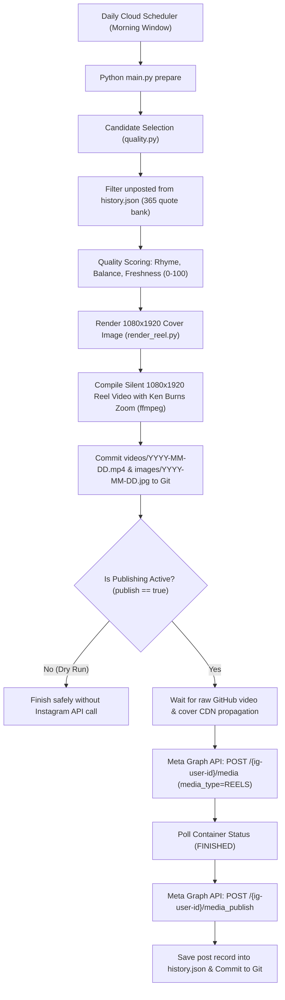

# Instagram Reels Auto-Publisher (@sabir_usmani_077)

Fully automated, production-grade Instagram Reels publishing system. Generates original Hindi motivational poetry and life lessons, renders 1080×1920 9:16 vertical silent videos with cinematic Ken Burns motion, selects the highest-scoring candidate automatically, and publishes to Instagram Reels every morning at **8:00 AM IST (02:30 UTC)**.

---

## 🌟 Identity & Branding Rules

* **Target Account:** `@sabir_usmani_077` (Instagram Creator Account)
* **Instagram Account ID:** `17841452472925398`
* **Watermark:** Strictly `@sabir_usmani_077` centered in the safe zone of every Reel.
* **Attribution:** `✍️ Original shayari | @sabir_usmani_077` in every caption.
* **No external brands:** No "MDK Enterprises" or third-party watermark on generated graphics.

---

## ⚙️ Architecture & Pipeline



---

## 🎬 Reel Specifications

* **Resolution:** 1080 × 1920 pixels (9:16 vertical portrait)
* **Video Codec:** H.264 (`yuv420p`, CRF 22, 30 fps) with `-movflags +faststart`
* **Audio Track:** Silent AAC stereo stream (compliant with Meta container requirements while playing with zero sound)
* **Duration:** 9 seconds (optimal for silent poetry reading and Instagram loop completion)
* **Safe Zone:** Text and watermarks strictly positioned within the central safe area (Y: 230 to 1500) to avoid overlay by Instagram's UI icons and bottom captions.

---

## 🔐 Required Secrets & Variables

### Repository Secrets (`Settings > Secrets and variables > Actions > Secrets`)
| Secret Name | Description | Required? |
|---|---|---|
| `IG_ACCESS_TOKEN` | Long-Lived Instagram User Access Token with `instagram_business_content_publish` | **Required** |
| `IG_USER_ID` | Your Instagram Account ID: `17841452472925398` | **Required** |
| `GH_PAT` | GitHub Personal Access Token (with `repo` permissions) to auto-update `IG_ACCESS_TOKEN` | *Optional (for automated 60-day token renewal)* |

---

## 🚀 Workflows

1. **Daily Instagram Reel (`daily.yml`)**:
   - Runs continuous morning attempts starting at `06:30 AM IST` (`01:00 UTC`).
   - Fast-skips in 3 seconds if today is already published.
   - Generates Reel MP4, cover image, voice narration, and publishes via Meta Graph API.
   - Can be triggered manually with `publish = true`.

2. **Refresh Instagram Token (`refresh-token.yml`)**:
   - Runs on the 1st and 15th of each month.
   - Refreshes your 60-day Instagram Long-Lived Token via Meta's `refresh_access_token` API.
   - Updates GitHub secret automatically if `GH_PAT` is configured.

---

## 📊 Content Queue

* **365 Original Hindi Quotes:** Pre-loaded in [`quotes.json`](quotes.json) covering themes:
  - `मेहनत` (Hard work)
  - `हौसला` (Courage)
  - `सब्र` (Patience)
  - `अनुशासन` (Discipline)
  - `सफलता` (Success)
  - `आत्मविश्वास` (Self-confidence)
  - `सपने` (Aspirations)
  - `ज़िंदगी` (Life lessons)
  - `वापसी` (Comeback & Resilience)
  - `उम्मीद` (Hope)
* **Automatic Warning:** The system alerts automatically when fewer than 7 unposted quotes remain.

---

## 🛠 Local Commands

```bash
# Run complete dry-run validation (generates Reel video, tests voice narration, verifies quality)
python main.py dryrun

# Prepare today's Reel video, cover & caption
python main.py prepare

# Publish prepared Reel (requires IG_ACCESS_TOKEN and IG_USER_ID)
python main.py publish
```