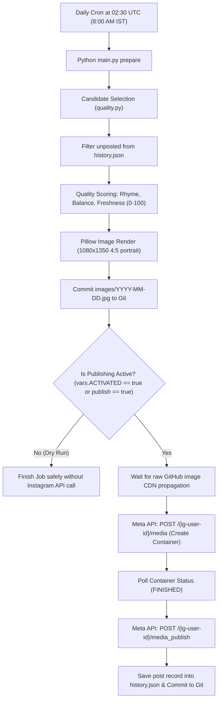

# Instagram Auto-Poster (@sabir_usmani_077)

Fully automated, production-grade Instagram publishing system. Generates original Hindi motivational poetry and life lessons, renders 1080×1350 portrait images with correct Devanagari typography, selects the highest-scoring candidate automatically, and publishes to Instagram every morning at **8:00 AM IST (02:30 UTC)**.

---

## 🌟 Identity & Branding Rules

* **Target Account:** `@sabir_usmani_077` (Instagram Creator Account)
* **Instagram Account ID:** `17841452472925398`
* **Watermark:** Strictly `@sabir_usmani_077` centered at the bottom of every image.
* **Attribution:** `✍️ Original shayari | @sabir_usmani_077` in every caption.
* **No external brands:** No "MDK Enterprises" or third-party watermark on generated graphics.

---

## ⚙️ Architecture & Pipeline



---

## 🔐 Required Secrets & Variables

### Repository Secrets (`Settings > Secrets and variables > Actions > Secrets`)
| Secret Name | Description | Required? |
|---|---|---|
| `IG_ACCESS_TOKEN` | Long-Lived Instagram User Access Token with `instagram_business_content_publish` | **Required** |
| `IG_USER_ID` | Your Instagram Account ID: `17841452472925398` | **Required** |
| `GH_PAT` | GitHub Personal Access Token (Fine-grained or Classic with `repo` / `secrets:write` permissions) to auto-update `IG_ACCESS_TOKEN` | *Optional (for automated 60-day token renewal)* |

### Repository Variables (`Settings > Secrets and variables > Actions > Variables`)
| Variable Name | Value | Purpose |
|---|---|---|
| `ACTIVATED` | `true` or `false` | When `true`, scheduled daily posts at 8:00 AM IST will publish to your live Instagram. When `false`, daily scheduled runs remain in safe dry-run mode. |

---

## 🚀 Workflows

1. **Daily Instagram Post (`daily.yml`)**:
   - Runs automatically at `02:30 UTC` (= 8:00 AM IST).
   - Can be triggered manually with `publish = true` or `publish = false`.
   - Prevents duplicate posts for the same day using `history.json`.

2. **Refresh Instagram Token (`refresh-token.yml`)**:
   - Runs on the 1st and 15th of each month.
   - Refreshes your 60-day Instagram Long-Lived Token via Meta's `refresh_access_token` API.
   - Updates GitHub secret automatically if `GH_PAT` is configured.

---

## 📊 Content Queue

* **365 Original Hindi Quotes:** Pre-loaded in [`quotes.json`](quotes.json) covering themes:
  - `मेहनत` (Hard work)
  - `हौसला` (Courage)
  - `सब्र` (Patience)
  - `अनुशासन` (Discipline)
  - `सफलता` (Success)
  - `आत्मविश्वास` (Self-confidence)
  - `सपने` (Aspirations)
  - `ज़िंदगी` (Life lessons)
  - `वापसी` (Comeback & Resilience)
  - `उम्मीद` (Hope)
* **Automatic Warning:** The system alerts automatically when fewer than 7 unposted quotes remain.

---

## 🛠 Local Commands

```bash
# Run complete dry-run validation (generates image, tests quality scoring, verifies caption)
python main.py dryrun

# Prepare today's image & caption
python main.py prepare

# Publish prepared post (requires IG_ACCESS_TOKEN and IG_USER_ID)
python main.py publish
```